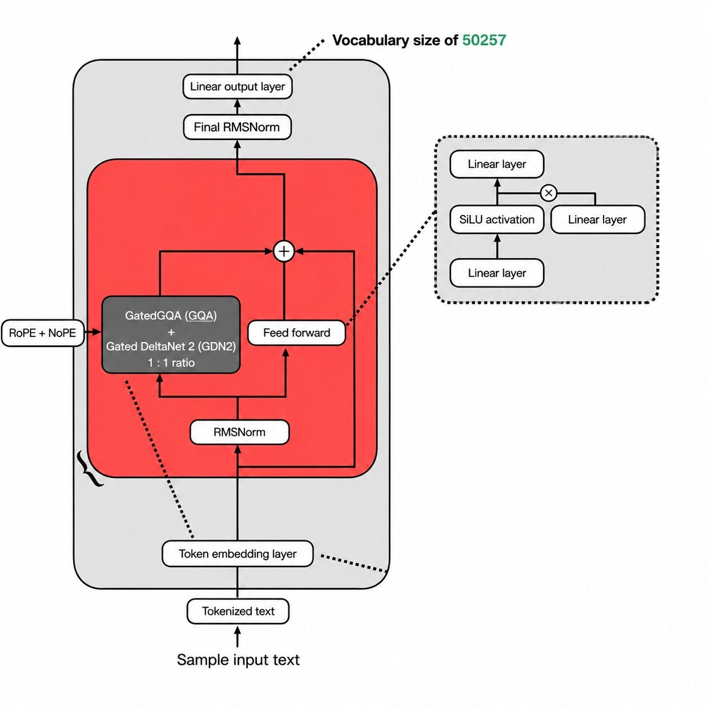

  <h1>Архитектура модели</h1>
  

<h4>

<h1>Triton ядра. Эффективность и ограничения.
<h4>
Из трёх ядер RMSNorm даёт максимальный относительный выигрыш (до 3.4× по bandwidth и 3× по памяти). Поскольку RMSNorm memory-bound, основная метрика пропускная способность:

Triton достигает ~415 GB/s на M≥4096, это ~82% от теоретического пика RTX 4070 Super (504 GB/s);

PyTorch в eager-режиме упирается в ~124 GB/s (~25% пика);

по bandwidth Triton превосходит PyTorch в 1.9–3.4× (в среднем ~2.8×).

Flash Attention даёт стабильный прирост в inference (+27% TFLOPS) и ощутимую экономию памяти в обучении (−53%). Однако на типичной конфигурации Dh=64 прирост сокращается до +5%, потому что backward SDPA (cuDNN/Flash) работает на паритетной скорости с Triton-реализацией backward. Потребление памяти снижено в среднем на 53% (до 68% на Dh=128), что позволяет увеличить batch/контекст при тех же ограничениях памяти.
  

SwiGLU FFN - умеренный, но устойчивый прирост (+5–13% forward) с сильной экономией delta-памяти в inference (−65.6%), благодаря логике с кэширование промежуточных матриц для backward.
Прирост относительно PyTorch: +5–13% на типичных формах и до +25–30% на малых M/N/K, где PyTorch теряет эффективность.

<h3>!Все замеры производились на видеокарте RTX 4070 Super с float16 типом данных!
